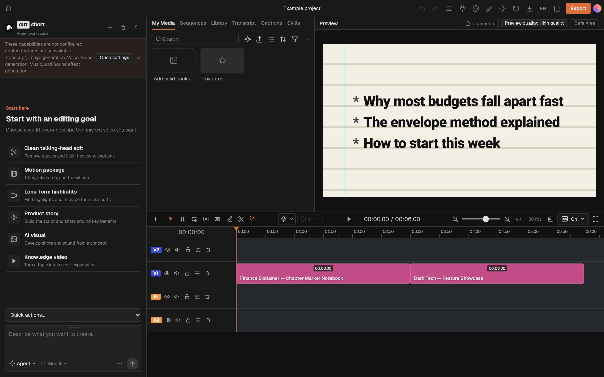
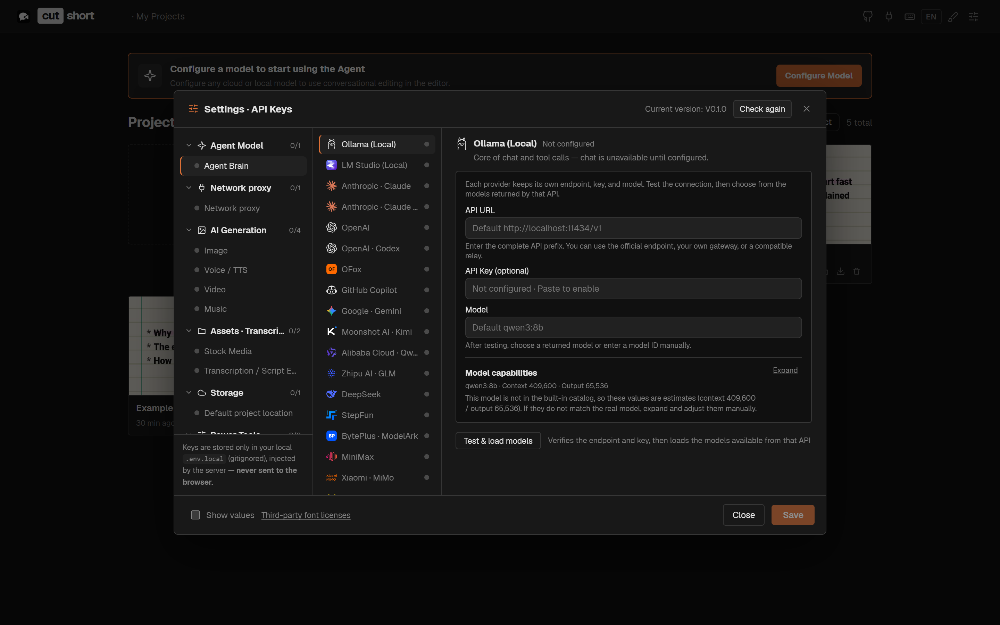

<p align="center">
  
</p>

<h1 align="center">cutshort</h1>

<p align="center">
  <strong>A local-first AI video editor for Windows: text, image and video AI in one app.</strong>
</p>

<p align="center">
  Built by <strong>Nayan</strong>, experimenting with AI ·
  <a href="https://github.com/nayanparakh">@nayanparakh</a>
</p>

<p align="center">
  
  
</p>

<p align="center">
  
</p>

cutshort is an open-source video editor that runs on your Windows PC. You get a
real multitrack timeline plus an AI agent that can cut, caption, and generate
media for you. Every agent edit lands on ordinary tracks and clips, so you can keep
editing by hand, undo, or export as usual.

Out of the box, AI runs **on your machine**: a local LLM (Ollama or LM Studio) for
the agent, and whisper.cpp for transcripts. Cloud providers are opt-in. They only
receive data when you add an API key for them in Settings.


## Features

- **Timeline**: multiple video and audio tracks, move/trim/split, ripple edits,
  snapping, keyframes, markers, undo/redo, transitions, LUTs, chroma key, zoom,
  WebGL effects.
- **Text-based editing**: word-level transcription (local whisper.cpp), cut by
  editing text, pause compression, speaker labels, styled and translated captions,
  SRT export.
- **AI agent**: conversational editing that writes to the real project. Defaults to
  local Ollama; any OpenAI-compatible or major cloud provider can be added.
- **AI generation** (optional providers): image, video, speech, music, sound effects.
- **Motion graphics**: editable templates rendered in a sandbox.
- **Audio**: voice-over recording, loudness control, auto-ducking, vocal isolation.
- **Export**: MP4 (hardware H.264 where available), audio, captions, FCPXML, full
  project import/export.

## Download and install (Windows)

1. Download **`cutshort-0.1.0-x64.exe`** from the
   [latest release](https://github.com/nayanparakh/cutshort/releases/latest).
2. Optional: check the file against the SHA-256 in the release notes:

   ```powershell
   Get-FileHash .\cutshort-0.1.0-x64.exe -Algorithm SHA256
   ```

3. Double-click the installer. It installs for your user only, so it doesn't need
   admin rights.
4. The installer isn't code-signed yet, so Windows SmartScreen may show
   **"Windows protected your PC"**. Choose **More info → Run anyway**.
5. Start **cutshort** from the Start menu or the desktop shortcut.

For local AI chat, also install [Ollama](https://ollama.com/) and run
`ollama pull qwen3:8b` (see [Local AI setup](#local-ai-setup)).

To uninstall, use **Settings → Apps → Installed apps → cutshort**.

## Requirements (building from source)

- Windows 10/11 x64
- [Node.js 24.x](https://nodejs.org/) and npm (see `.nvmrc`)
- Git
- Optional, for local AI chat: [Ollama](https://ollama.com/) with a tool-calling
  model, for example `ollama pull qwen3:8b`

## Quick start (from source)

```bash
git clone https://github.com/nayanparakh/cutshort.git
cd cutshort
npm ci
copy .env.example .env.local
npm run dev
```

Open http://localhost:5199. The first `npm run dev` provisions MediaPipe models and
the whisper.cpp CLI from their official sources, and verifies each file's SHA-256
before installing it.

Desktop app (Electron):

```bash
npm run desktop:dev
```

Build a Windows installer (output in `release/`):

```bash
npm run desktop:dist
```

## Local AI setup

1. Install Ollama and pull a model: `ollama pull qwen3:8b`.
2. Start cutshort. With nothing configured, the agent uses Ollama at
   `http://localhost:11434/v1`.
3. To pick another model or provider (LM Studio, OpenAI, Anthropic, Gemini, …), use
   **Settings → Model**. Keys stay in the local server keystore under your profile.

Transcription uses whisper.cpp locally. Its speech model downloads the first time you
transcribe.

<p align="center">
  
</p>

## Data and privacy

- Projects, media and settings live on your machine (`%USERPROFILE%\.cutshort` and
  the browser's IndexedDB).
- cutshort has no telemetry. The only update check asks
  [GitHub Releases for this repo](https://github.com/nayanparakh/cutshort/releases)
  for the latest version.
- The online extension registry is off unless `VITE_RESOURCE_REGISTRY_URL` is set.
- Network calls happen only to providers you configure, or to stock-media search
  when you use it.

## Agent / MCP

cutshort exposes a Streamable HTTP MCP endpoint at
`http://localhost:5199/api/external-mcp/mcp`, so Claude Code or Codex can drive the
editor. See `skills/cutshort/` for the agent skill.

## Project layout

| Path | Contents |
| --- | --- |
| `src/` | Editor UI, state, agent, transcript, captions, WebGL |
| `server/` | Local services: generation, transcription, media, export, storage |
| `desktop/` | Electron main process and native inference workers |
| `remotion/` | Headless rendering and export |
| `shared/` | Contracts shared by browser, server and desktop |
| `skills/cutshort/` | Agent skill for external agents |

## Security

The upstream source was audited before import. See
[SECURITY-AUDIT.md](SECURITY-AUDIT.md) for what was checked and what was changed.

## Credits

cutshort is a project by **Nayan**, experimenting with AI. It builds on the excellent
[OpenChatCut](https://github.com/0xsline/OpenChatCut) by 0xsline and its contributors.

